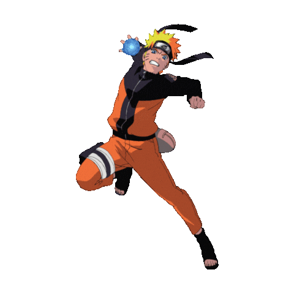
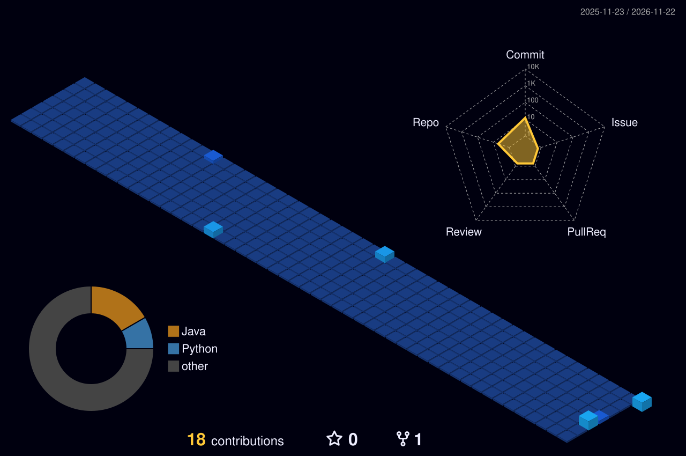
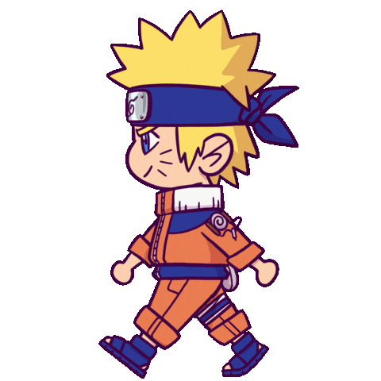

<!-- 🎬 HERO BANNER & INTRO -->

  

<!-- 🍥 TEAM 7 CHIBI DANCE -->

 

<!-- 🍥 MY NINJA WAY -->

  

<!-- 🔦 JUTSU ARSENAL (TECH STACK) -->

  

<!-- 🪪 NINJA REGISTRATION + LIVE MISSION DASHBOARD -->

  

## 🍥 S-Rank Missions & Featured Projects

<table>
<tr><th>Mission / Project</th><th>What it is</th><th>Jutsu Used</th><th align="center">Rank</th></tr>
<tr><td><b>🔥 Rasengan Engine</b></td><td>Cinematic anime interactive web experience with scroll-driven sound & GSAP transformations</td><td><code>TypeScript</code> <code>GSAP</code> <code>Three.js</code></td><td align="center"><b>S-Rank</b></td></tr>
<tr><td><b>⚡ Chidori Stream API</b></td><td>High-throughput asynchronous microservice architecture with sub-millisecond response latency</td><td><code>Node.js</code> <code>Python</code> <code>FastAPI</code></td><td align="center"><b>S-Rank</b></td></tr>
<tr><td><b>👁️ Sharingan UI Kit</b></td><td>Apple-inspired glassmorphism component system built with dark-mode cyberpunk accents</td><td><code>React</code> <code>Next.js</code> <code>Tailwind</code></td><td align="center"><b>A-Rank</b></td></tr>
<tr><td><b>🍃 Hidden Leaf Vault</b></td><td>Zero-knowledge encrypted cloud storage & authentication service</td><td><code>Go</code> <code>Docker</code> <code>PostgreSQL</code></td><td align="center"><b>A-Rank</b></td></tr>
<tr><td><b>🦊 Kurama Chakra Bot</b></td><td>Automated multi-agent orchestrator & developer automation pipeline</td><td><code>Python</code> <code>LangChain</code> <code>AI API</code></td><td align="center"><b>S-Rank</b></td></tr>
</table>

 

### 🌃 My Contribution Village (3D Isometric Activity)

*Every commit raises another tower in the village — updated automatically at midnight.*

  

### 🐍 Chakra Snake (Eating My Commits)

<picture>
  <source media="(prefers-color-scheme: dark)" srcset="https://raw.githubusercontent.com/HUNTER0019-TECH/HUNTER0019-TECH/output/github-snake-orange.svg">
  <source media="(prefers-color-scheme: light)" srcset="https://raw.githubusercontent.com/HUNTER0019-TECH/HUNTER0019-TECH/output/github-snake.svg">
  
</picture>

  

<!-- 💌 JOIN THE SQUAD / CONNECT -->

 

  

<!-- 👁️ PROFILE VISITOR COUNTER -->

  

 

**Dattebayo — keep coding, keep growing.** 🍥

